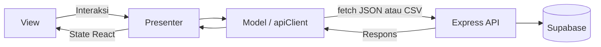

# Ogi Resto Frontend

Frontend Next.js App Router dan React untuk pemesanan catering serta administrasi.
Data permanen disimpan oleh backend Express ke Supabase; frontend tidak memiliki
Supabase client atau key database.

## Halaman dan fitur

| Route / tab | Fungsi |
| --- | --- |
| `/` | Katalog menu, hari pemesanan, pencarian/kategori, keranjang, checkout |
| `/ogi` | Membuka aplikasi dengan panel admin |
| Manajemen Menu & Jadwal Mingguan | Tambah, edit, hapus menu dan atur ketersediaan per hari |
| Riwayat Pesanan & Laporan CSV | Filter pesanan, ringkasan transaksi, ekspor |
| Rekap Kasbon Bulanan | Rekap harian per karyawan, total utang, konfirmasi pembayaran |
| Riwayat Pembayaran | Tambah manual, edit, hapus, pagination, dan laporan WhatsApp |

Route admin bukan pengganti autentikasi. Backend memeriksa token setiap request admin.
Aplikasi menampilkan rekening transfer BCA dan tidak memproses payment gateway.

## Rekening pembayaran

Informasi pembayaran yang ditampilkan kepada pelanggan:

```text
0690595664
BCA
A/n: Ogi Nur Saputra
```

Rekening ditampilkan pada dialog header **Lihat No. Rek** dan pada struk melalui
**Bayar Sekarang (Buka Rekening)**. Tampilan menggunakan komponen bersama
`app/views/BankAccountDetails.js`; nilai rekening berada di
`app/models/paymentInfo.js`. Nomor rekening berupa string untuk mempertahankan
nol di depan dan dapat diseleksi untuk disalin. CSS kartu menyesuaikan mobile
sampai desktop.

Petunjuk checkout mengikuti teks:
**Pada struk nanti akan tersedia tombol untuk membuka Nomer Rekenening.**

Label pelanggan, struk yang dibagikan, dan laporan admin memakai
**Cash / Transfer**. Nilai API tetap `Cash` atau `Kasbon` agar kompatibel dengan
rekap yang sudah ada. Tidak ada verifikasi transfer otomatis. Gambar dan tombol
unduh QRIS pembayaran tidak lagi digunakan pada tampilan.

## Struktur Model-View-Presenter

```text
app/
  page.js                         Halaman pelanggan
  ogi/page.js                     Membuka panel admin
  layout.js                       Layout aplikasi
  globals.css                     CSS responsif
  models/                         API dan fungsi data
  presenters/                     State React serta koordinasi interaksi
  views/                          Komponen tampilan
    admin/                        Form dan tab administrasi
```

| Komponen | Peran |
| --- | --- |
| `models/apiClient.js` | Base URL, fetch JSON, header Bearer, query string, error HTTP, unduh CSV |
| `models/authModel.js` | Login, validasi sesi, simpan/hapus token localStorage |
| `models/menuModel.js` | Katalog, CRUD menu admin, simpan jadwal |
| `models/orderModel.js` | Checkout, riwayat, unduh CSV pesanan/kasbon |
| `models/kasbonModel.js`, `kasbonReportModel.js` | Request dan pemetaan laporan kasbon |
| `models/paymentHistoryModel.js` | Daftar, tambah, edit, hapus riwayat pembayaran |
| `models/dateModel.js`, `cartModel.js` | Tanggal bisnis dan perhitungan keranjang |
| `presenters/useCateringPresenter.js` | Koordinator utama aplikasi, login, tab, menu/jadwal, dan riwayat |
| `useCustomerOrderPresenter.js` | State keranjang dan proses checkout |
| `useOrderSchedulePresenter.js` | Pilihan hari ini, besok, tanggal lain berdasarkan WIB |
| `useKasbonPresenter.js` | Periode dan konfirmasi pelunasan |
| `usePaymentHistoryPresenter.js` | Form, pagination, edit, konfirmasi hapus, loading, dan refresh |
| `views/CateringView.js` | Komposisi halaman dari data dan handler presenter |
| `views/admin/` | Tampilan masing-masing tab dan form admin |

View menampilkan data dan memanggil handler. Presenter mengatur state, memanggil
model, serta menerjemahkan respons menjadi tampilan. Model membungkus request
backend. Aturan penyimpanan, otorisasi, dan validasi final berada di backend.

## Komunikasi API



Saat lokal, browser memanggil `/api/*` pada origin frontend. Rewrite pada
`next.config.mjs` meneruskannya ke `http://localhost:5000/api/*`.
Jika `NEXT_PUBLIC_API_URL` diisi URL publik backend, browser memanggil host itu
langsung. URL harus berakhiran `/api`.

Admin login melalui `/api/auth/login`. Token disimpan di localStorage dengan key
`ogi_admin_token`; model mengirim `Authorization: Bearer TOKEN`.
Backend menggunakan token internal HMAC dengan masa berlaku 24 jam, bukan
Supabase Auth. Respons 401 memicu pembersihan sesi pada penanganan presenter.

Data yang diterima bisa menggunakan snake_case backend, sedangkan state/form
tertentu menggunakan camelCase; model/presenter melakukan pemetaan sesuai fitur.

## Relasi data yang ditampilkan

- Katalog adalah gabungan master `menus` dan `menu_schedules` berdasarkan hari.
- Checkout membuat `orders`; item adalah snapshot JSONB, bukan relasi FK ke menu.
- Rekap kasbon menggabungkan agregasi pesanan periode dengan `kasbon_payments`.
  Identitas dihitung dari nama, perusahaan, dan divisi yang dinormalisasi.
- Riwayat pembayaran membaca `history_payments`, tabel tersendiri tanpa FK
  ke pesanan/kasbon. Mencatat pembayaran tidak otomatis mengubah status lunas.
- Frontend tidak menggabungkan pesan WhatsApp langsung. Bot/webhook menyimpan
  melalui backend, kemudian frontend mengambil daftar pembayaran melalui API.

Pada rekap bulanan, Cash tidak menambah total utang Kasbon. Konfirmasi admin
mengacu bulan tagihan yang dipilih meskipun waktu pembayaran berbeda bulan.

## Riwayat pembayaran

Admin mengisi nama, perusahaan, divisi, dan tanggal. Tanggal awal form memakai
hari ini dalam WIB dan tetap dapat dipilih untuk input manual. Edit/hapus
memerlukan respons sukses backend sebelum UI menampilkan keberhasilan.
Presenter membatasi klik simpan bersamaan dan mengabaikan respons sesi yang sudah
tidak aktif.

Data ditampilkan 50 baris per halaman. Tombol Muat Ulang mengambil catatan baru
yang masuk melalui WhatsApp. Belum ada subscription Supabase Realtime atau
pembaruan push dari bot ke browser.

Sumber ditampilkan sebagai Manual atau WhatsApp berdasarkan ID pesan yang
tersimpan. Penghapusan adalah soft delete di backend; catatan tidak muncul
di daftar tetapi ID pesan tetap dipertahankan untuk deduplikasi.

## Menjalankan

Dari folder frontend:

```powershell
npm.cmd ci
# Hanya instalasi baru:
Copy-Item .env.example .env.local
npm.cmd run dev
```

Backend harus berjalan di port 5000 untuk rewrite lokal.
Buka `http://localhost:3000` atau `http://localhost:3000/ogi`.

Isi environment lokal:

```dotenv
NEXT_PUBLIC_API_URL=/api
```

Untuk host backend terpisah:

```dotenv
NEXT_PUBLIC_API_URL=https://DOMAIN_BACKEND/api
```

Restart development server setelah mengganti env. Untuk deployment, rebuild
frontend agar nilai publik yang baru terpakai. `localhost` pada hosting tidak
menunjuk ke laptop Anda. Saat memakai tunnel frontend di mesin yang sama,
rewrite masih dapat meneruskan request ke backend lokal.

Jangan masukkan service_role Supabase, App Secret Meta, kunci sesi bot, atau
secret token backend ke `NEXT_PUBLIC_*`; nilainya dapat terlihat di browser.
Kredensial admin mengikuti konfigurasi backend, bukan nilai di kode frontend.

## Pemeriksaan dan produksi

```powershell
npm.cmd test
npm.cmd run lint
npm.cmd run build
npm.cmd start
```

`start` menjalankan hasil build Next.js. Tes frontend memeriksa model dan perilaku
presenter; tidak menggantikan uji alur browser dengan API/database sungguhan.

Jika pembayaran sudah ada di Supabase tetapi belum tampil, tekan Muat Ulang,
periksa respons request admin, dan pastikan API serta bot memakai project
Supabase yang sama. Jika muncul 401, login kembali. Jika API gagal terhubung,
periksa base URL dan health endpoint backend.
